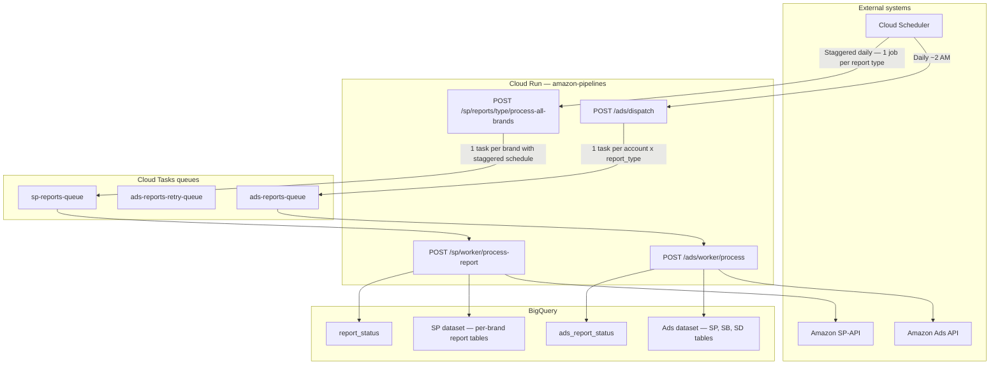
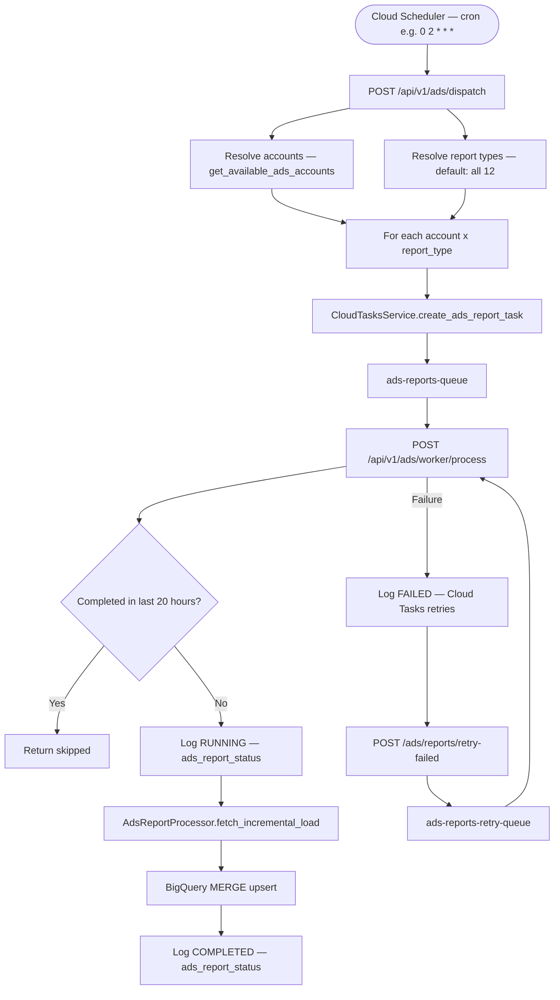
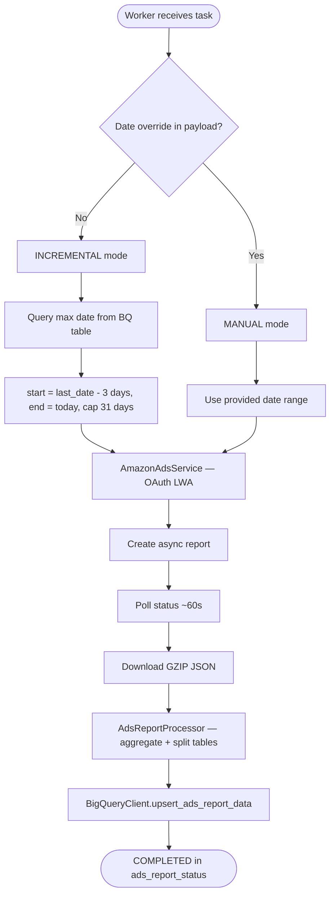
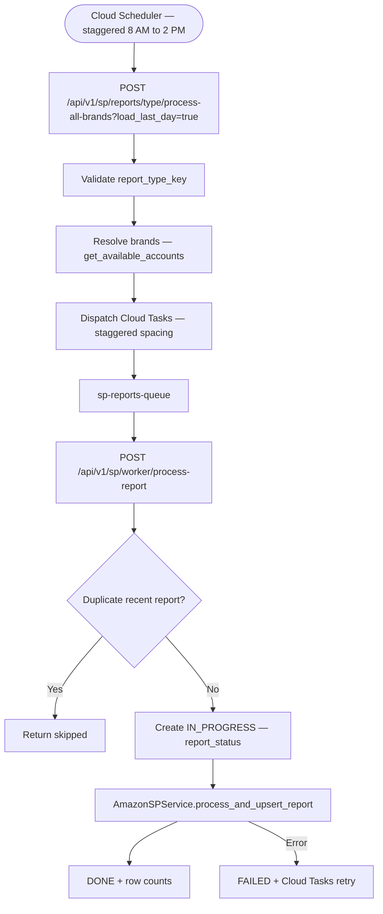
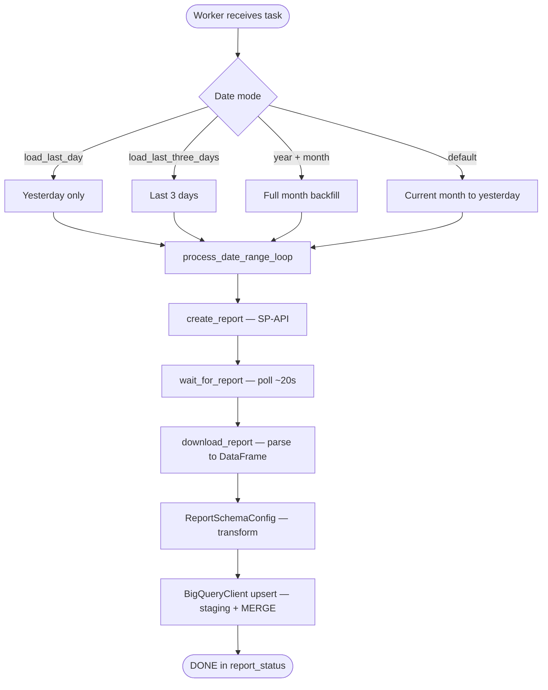
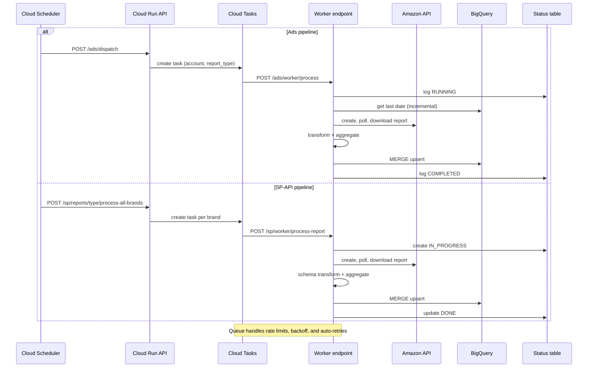

# Data Flow

Visual workflow diagrams for the **Amazon Ads API** and **SP-API** pipelines. These reflect the current implementation in `app/routes/ads_jobs.py`, `app/routes/jobs.py`, and `app/utils/cloud_tasks.py`.

## Shared architecture

Both pipelines run on the same **Cloud Run** service (`amazon-pipelines`) and share the **Cloud Tasks → worker** pattern, but differ in dispatch triggers and date range resolution.

## Ads API pipeline

**Primary path:** one Cloud Scheduler job calls `/ads/dispatch`, which fans out to **accounts × 12 report types** as individual Cloud Tasks.

### Ads worker detail

## SP-API pipeline

**Primary path:** one Cloud Scheduler job **per report type** (7 jobs, staggered) calls `process-all-brands`, which dispatches one Cloud Task per brand.

### SP worker detail

## Sequence — single task lifecycle

## Related pages

- [Architecture Overview](/architecture/)
- [SP Pipeline](/pipelines/sp-pipeline)
- [Ads Pipeline](/pipelines/ads-pipeline)
- [Data Flow & Processing](/pipelines/data-flow-processing)
- [Batch Scheduling](/pipelines/batch-scheduling)
