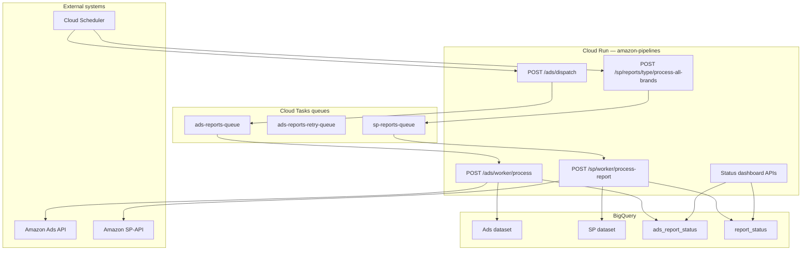

# Architecture Overview

Amazon Pipelines is a **FastAPI** service deployed on **Google Cloud Run** that orchestrates data extraction from Amazon SP-API and Amazon Ads API, transforms report data using schema-driven pipelines, and persists results to **BigQuery**.

## Design principles

1. **External scheduling** — Cloud Scheduler triggers batch endpoints; no in-process cron
2. **Async fan-out** — Cloud Tasks dispatches parallel workers per brand/report
3. **Schema-driven upserts** — Each report type defines BigQuery schema, merge keys, and transformations
4. **Status tracking** — Every pipeline run writes to BigQuery status tables for observability
5. **Multi-account** — Shared CP app credentials with per-brand refresh tokens and Ads profile IDs

## High-level topology



## Pipeline comparison

| Aspect | SP-API | Ads API |
|--------|--------|---------|
| **Scheduler pattern** | 7 jobs → one per report type | 1 job → `/ads/dispatch` |
| **Fan-out unit** | brands per report type (~8 tasks) | account × report type (~348 tasks) |
| **Primary queue** | `sp-reports-queue` | `ads-reports-queue` |
| **Retry queue** | Cloud Tasks retries on main queue | `ads-reports-retry-queue` |
| **Date logic** | `load_last_day`, 3-day, month backfill | Incremental from BQ max date − 3 days |
| **Status table** | `report_status` | `ads_report_status` |
| **Idempotency** | Skip duplicate recent report for date range | Skip if COMPLETED in 20 h |

## Code structure

```
amazon-pipelines/
├── app/
│   ├── main.py                 # FastAPI entry point
│   ├── config.py               # Settings & AccountConfig
│   ├── routes/                 # HTTP endpoints (7 modules)
│   ├── services/sp/            # SP API, BQ client, status tracker
│   ├── services/ads/           # Ads API, processor, tracker
│   ├── schemas/sp/             # SP report schemas
│   ├── schemas/ads/            # Ads report schemas
│   └── utils/                  # auth, cloud_tasks, cache, logger
├── scripts/                    # Operational CLI tools
├── cloudbuild.yaml             # Cloud Build → Cloud Run deploy
└── Dockerfile
```

## Key services

| Service | Location | Role |
|---------|----------|------|
| `AmazonSPService` | `app/services/sp/amazon_sp.py` | SP-API report lifecycle |
| `AmazonAdsService` | `app/services/ads/amazon_ads.py` | Ads API report lifecycle |
| `AdsReportProcessor` | `app/services/ads/report_processor.py` | Transform & incremental load |
| `BigQueryClient` | `app/services/sp/bigquery_client.py` | MERGE upserts |
| `ReportStatusTracker` | `app/services/sp/report_status_tracker.py` | SP status in `report_status` |
| `AdsReportTracker` | `app/services/ads/ads_report_tracker.py` | Ads status in `ads_report_status` |
| `CloudTasksService` | `app/utils/cloud_tasks.py` | Task dispatch to workers |

## Data stores

| Dataset | Default name | Contents |
|---------|--------------|----------|
| SP | `amz_sp_api_reports_v1` | `{Account}_{report_type}` tables, `report_status`, `account_details` |
| Ads | `amz_ads_api_reports_v1` | `SP_*`, `SB_*`, `SD_*` tables, `ads_report_status` |

See [BigQuery & Datasets](/reference/bigquery) for naming conventions.

## Related pages

- [Data Flow Diagrams](/architecture/data-flow) — detailed Mermaid workflows
- [Components](/architecture/components) — queues, workers, caching
- [API Endpoints](/reference/endpoints) — full routing map
- [Deployment](/deployment/) — infrastructure topology
