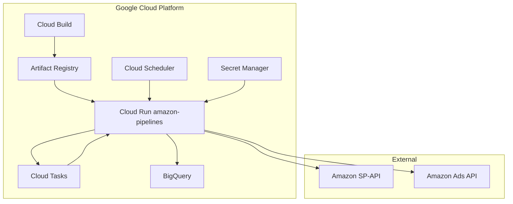

# Infrastructure

Google Cloud Platform topology for the Amazon Pipelines platform.

## Architecture diagram



## GCP project

| Setting | Value |
|---------|-------|
| Project ID | `research-analytics-v1` |
| Region | `us-central1` |
| Service account | `fastapi-bq-acess@research-analytics-v1.iam.gserviceaccount.com` |

## Service account permissions

The Cloud Run service account needs:

| Role | Purpose |
|------|---------|
| `roles/bigquery.dataEditor` | Read/write BigQuery tables |
| `roles/bigquery.jobUser` | Run BigQuery queries |
| `roles/secretmanager.secretAccessor` | Read Secret Manager secrets |
| `roles/cloudtasks.enqueuer` | Create Cloud Tasks |

## BigQuery datasets

| Dataset | Location | Contents |
|---------|----------|----------|
| `amz_sp_api_reports_v1` | US | SP reports, `report_status`, `account_details` |
| `amz_ads_api_reports_v1` | US | Ads reports, `ads_report_status` |

## Secret Manager

Production credentials are injected via `cloudbuild.yaml` `--set-secrets` bindings (50+ secrets). Each env var maps 1:1 to a Secret Manager secret name.

Non-sensitive config uses `--set-env-vars`:

```
ENV=production
BIGQUERY_DATASET=amz_sp_api_reports_v1
SP_API_REGION=us-east-1
CLOUD_TASKS_PROJECT=research-analytics-v1
CLOUD_TASKS_LOCATION=us-central1
CLOUD_TASKS_QUEUE=ads-reports-queue
SP_CLOUD_TASKS_QUEUE=sp-reports-queue
CLOUD_RUN_SERVICE_URL=https://amazon-pipelines-vaw23nw3ja-uc.a.run.app
```

## Security {#security}

### Current model

| Layer | Configuration |
|-------|---------------|
| Cloud Run ingress | `--allow-unauthenticated` (public HTTP) |
| FastAPI middleware | No inbound auth (no API keys, JWT, or Depends) |
| Cloud Tasks → Cloud Run | OIDC via `CLOUD_TASKS_SERVICE_ACCOUNT` |
| Cloud Scheduler → Cloud Run | OIDC service account |
| Credentials in responses | Never exposed (presence flags only) |
| CORS | Permissive (`allow_origins=["*"]`) |

### Implications

Worker endpoints (`/sp/worker/process-report`, `/ads/worker/process`) are technically callable by anyone who knows the URL. In practice, Cloud Tasks uses OIDC and external callers would need to mimic task payloads.

### Recommended hardening (future)

- Enable Cloud Run IAM authentication for non-worker endpoints
- API gateway with API key or OAuth for external access
- VPC connector for internal-only networking
- Restrict CORS to known frontend origins

## Network

Cloud Run service accepts HTTPS traffic on port 8080. Cloud Tasks and Cloud Scheduler invoke the service URL directly.

## Related pages

- [Cloud Run](/deployment/cloud-run)
- [Cloud Tasks & Scheduler](/deployment/cloud-tasks-scheduler)
- [Credentials & Auth](/onboarding/credentials)
