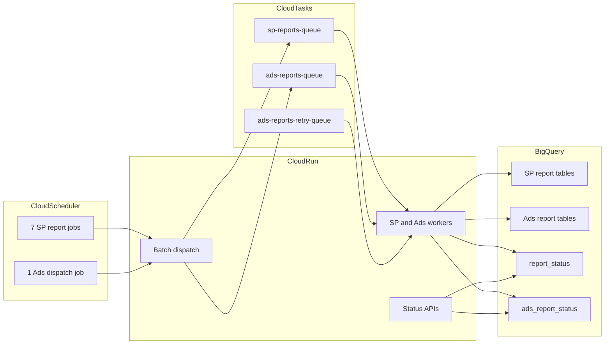

## Who is this documentation for?

| Audience | Start here |
|----------|------------|
| **Business / product stakeholders** | [Platform overview](/) → [Architecture](/architecture/) → [FAQ](/faq) |
| **Operations / on-call** | [Operations Runbook](/operations/) → [Monitoring](/operations/monitoring) → [Failed Reports](/operations/failed-reports) |
| **Engineers onboarding a brand** | [Brand Onboarding](/onboarding/brand-onboarding) → [Credentials](/onboarding/credentials) |
| **Developers extending pipelines** | [Developer Guide](/developer/) → [SP Schemas](/reference/sp-schemas) → [API Reference](/reference/endpoints) |

## Platform at a glance

## Report coverage

| Pipeline | Report types | Dataset |
|----------|-------------|---------|
| **SP-API** | 7 (orders, inventory, listings, sales, returns, FBA, FYP) | `amz_sp_api_reports_v1` |
| **Ads API** | 12 (SP, SB, SD campaigns, targeting, search terms, etc.) | `amz_ads_api_reports_v1` |

## Live API documentation

The running service exposes interactive OpenAPI docs at `/docs` on the deployed Cloud Run URL. This site covers architecture, operations, and reference material that complements Swagger.

## Related links

- [Getting Started](/getting-started) — local setup and first API calls
- [Pipeline Workflows](/architecture/data-flow) — detailed Mermaid diagrams
- [Batch Scheduling](/pipelines/batch-scheduling) — Cloud Scheduler patterns
- [Deployment](/deployment/) — Cloud Run production setup
